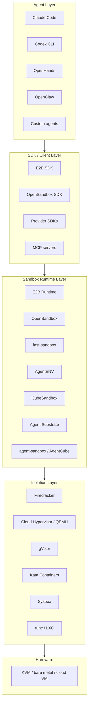
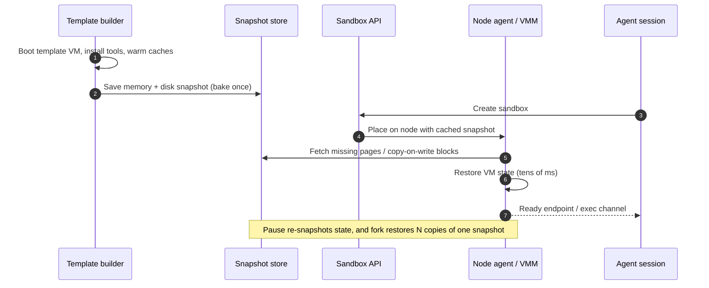

# Awesome Agent Sandbox

> Curated list of agent sandbox runtimes, isolation technologies, and infrastructure for AI coding agents.

AI coding agents no longer just autocomplete. They run shells, install packages, edit files, browse the web, and call tools. Every one of those actions is untrusted code execution. An **agent sandbox** is the isolation layer that lets an agent act with real capabilities while keeping the host, the user's data, and other tenants out of reach.

**Every link below was checked against its official repository or documentation. The list favors verified, maintained projects over exhaustive coverage.**

## Contents

Click to expand

- [Awesome Agent Sandbox](#awesome-agent-sandbox)
  - [Contents](#contents)
  - [Frequently Asked Questions (F.A.Q.s) & Answers](#frequently-asked-questions-faqs--answers)
  - [Isolation Technology Landscape](#isolation-technology-landscape)
  - [Ecosystem at a Glance](#ecosystem-at-a-glance)
  - [Open-Source Runtimes](#open-source-runtimes)
  - [Managed Platforms](#managed-platforms)
  - [Isolation Technologies](#isolation-technologies)
  - [SDKs & Client Libraries](#sdks--client-libraries)
  - [Orchestration & Scheduling](#orchestration--scheduling)
  - [Snapshots & Fast Startup](#snapshots--fast-startup)
  - [Agent Integration & Skills](#agent-integration--skills)
  - [Benchmarks & Evaluation](#benchmarks--evaluation)
  - [Related Lists](#related-lists)
  - [Contribute](#contribute)
  - [License](#license)

## Frequently Asked Questions (F.A.Q.s) & Answers

**Q: What's an Agent Sandbox?**

A: An agent sandbox is an execution environment that gives an AI agent a real computer — shell, filesystem, network, and tools — while enforcing a security boundary around everything the agent does. The boundary can be a container, a user-space kernel, or a hardware-virtualized microVM. A complete sandbox usually has four parts: an **isolation runtime**, a **lifecycle/control plane** (create, pause, resume, delete), an **SDK or API** for the agent, and a **snapshot or warm-pool path** for fast startup.

**Q: Why do coding agents need one?**

A: Coding agents execute model-generated commands, install arbitrary dependencies, and touch repositories, credentials, and networks. Without isolation, a prompt injection, a hallucinated `rm -rf`, or a malicious dependency can damage the developer machine or leak secrets. Sandboxes also make agents reproducible (start from a known snapshot), parallel (many isolated workers), and resumable (pause an idle session and restore it later).

**Q: How is an agent sandbox different from a normal container?**

A: A normal container shares the host kernel. Namespaces, cgroups, and seccomp are packaging and resource-isolation tools, not a security boundary against hostile code. Agent sandboxes usually add a stronger boundary — gVisor's user-space kernel, Kata's lightweight VM, or a Firecracker microVM — plus lifecycle and snapshot APIs designed for thousands of short-lived, stateful sessions. Some products still use plain containers behind a policy layer; know which boundary you are getting.

**Q: What is a warm pool or snapshot restore?**

A: Cold-starting a VM or container can take seconds. A warm pool keeps pre-created instances (or pre-booted VMs) ready for claim. Snapshot restore skips boot entirely by resuming a saved memory and disk image. The fastest production sandboxes combine both: a baked template snapshot plus a pool of nodes that already cache it.

**Q: Which isolation level should I choose?**

A: Match the boundary to the threat model. Trusted CI and local development can use containers. Multi-tenant untrusted code usually wants gVisor or a microVM. Strongly adversarial or regulated workloads want hardware virtualization with a minimal device model (Firecracker or Cloud Hypervisor), optionally with confidential computing. The table below summarizes the trade-offs.

## Isolation Technology Landscape

| Technology | Isolation boundary | Overhead | Snapshot / restore | Typical use |
|---|---|---|---|---|
| **microVM** (Firecracker / Cloud Hypervisor / QEMU) | Hardware virtualization via KVM. Each sandbox has its own guest kernel; Firecracker keeps the device model minimal, while Cloud Hypervisor and QEMU expose richer virtio devices | Firecracker: roughly 5 MB VMM footprint, about 100 ms cold boot, tens of ms from snapshot; Cloud Hypervisor and QEMU are heavier | Yes — full VM memory and device state. The basis of most sub-second sandbox starts | Serverless, multi-tenant agent sandboxes, untrusted code |
| **gVisor** | User-space kernel (Sentry) intercepts syscalls; the application never talks to the host kernel directly | Medium — syscall interception and file proxy add per-I/O cost; some syscall gaps | Yes — `runsc` checkpoint/restore (connected sockets need an explicit flag) | Kubernetes sandboxed pods, multi-tenant code execution |
| **Kata Containers** | Lightweight VM per pod or container with a guest kernel, OCI-compatible | Medium-high — VM boot and task creation, roughly 0.8–2 s cold start | Yes — VM templating and VMM snapshot/restore, backend-dependent | Kubernetes untrusted workloads, confidential containers |
| **Sysbox** | Enhanced `runc` with user namespaces and virtualized procfs/sysfs; still a shared kernel | Low — container-like | No native CRIU-style checkpoint/restore | Dev environments, Docker-in-Docker, systemd inside containers |
| **Container** (`runc`) | Namespaces, cgroups, capabilities, and seccomp; shared host kernel | Lowest — tens of ms when warm | Only via CRIU or runtime-specific checkpointing | Local development, CI, trusted workloads |
| **LXC** | System containers with namespaces and cgroups; shared kernel, full init system | Low | Via CRIU (optional) | Lightweight VMs, dev and test environments |

## Ecosystem at a Glance

The same request can be served at very different layers. A coding agent may call a managed sandbox API directly, go through a self-hosted runtime, or run inside a Kubernetes control plane. The isolation layer is what ultimately defines the security boundary.

### Snapshot and Warm-Start Path

## Open-Source Runtimes

Self-hostable control planes and runtime layers that create, isolate, and manage agent execution environments. Some are complete platforms; others are the runtime backend behind one.

- [OpenSandbox](https://github.com/opensandbox-group/OpenSandbox) - General-purpose sandbox platform from Alibaba with multi-language SDKs, a unified API, Docker and Kubernetes runtimes, and pluggable gVisor, Kata, or Firecracker isolation. (17k★)
- [E2B Runtime](https://github.com/e2b-dev/runtime) - The open-source backend behind E2B Cloud: control plane, per-node orchestrator, in-VM agent, and edge router for Firecracker microVMs restored from snapshots. (1.8k★)
- [fast-sandbox](https://github.com/opensandbox-group/fast-sandbox) - Kubernetes-native runtime plane that hosts many Firecracker sandboxes per warm Fastlet Pod and restores each one from a prepared snapshot.
- [AgentENV](https://github.com/kvcache-ai/AgentENV) - Distributed platform for running agent environments at scale, powering agentic RL for Kimi K3 with Firecracker microVMs, on-demand OCI images, and sub-100 ms snapshot and fork. (3.7k★)
- [CubeSandbox](https://github.com/TencentCloud/CubeSandbox) - Tencent Cloud's E2B-compatible microVM sandbox service built on RustVMM and KVM, with hardware-level isolation and sub-60 ms creation. (13k★)
- [Agent Substrate](https://github.com/agent-substrate/substrate) - Zero-trust Kubernetes runtime that maps many stateful agents onto a small pool of warm workers, supporting gVisor and Cloud Hypervisor sandboxes with sub-500 ms resume. (6.4k★)
- [Agent-Sandbox](https://github.com/agent-sandbox/agent-sandbox) - Self-hosted, E2B-protocol-compatible sandbox platform on Kubernetes with a REST API, MCP server, pools, pause/resume, and snapshots.
- [Arrakis](https://github.com/abshkbh/arrakis) - Self-hosted microVM sandbox for agent code execution and computer use, with REST and Python APIs, port forwarding, and snapshot-based backtracking.
- [AgentBox](https://github.com/madarco/agentbox) - Runs multiple coding agents in parallel sandboxed VMs locally, self-hosted, or on cloud providers, with sub-second checkpoints.
- [Flintlock](https://github.com/liquidmetal-dev/flintlock) - MicroVM lifecycle manager backed by containerd, intended as a building block for higher-level sandbox platforms. (1.5k★)
- [microsandbox](https://github.com/superradcompany/microsandbox) - Local-first, programmable microVM runtime and library with VM-level isolation and sub-200 ms boot. (9k★)
- [SandboxFusion](https://github.com/bytedance/SandboxFusion) - ByteDance's secure code-execution and judging service for LLM-generated code, supporting 20+ languages with request-level isolation. (1.1k★)
- [AIO Sandbox](https://github.com/agent-infra/sandbox) - All-in-one container image bundling a browser, shell, filesystem, MCP, and VS Code Server as an agent environment template. (6.3k★)
- [ROCK](https://github.com/alibaba/ROCK) - Alibaba's sandbox environment management framework for agentic reinforcement learning, with Docker, Ray, and Kubernetes backends and pool-based warm allocation.

## Managed Platforms

Hosted sandbox APIs and cloud computers. Most bill per second and expose an SDK; the isolation boundary ranges from containers to Firecracker microVMs.

- [E2B](https://e2b.dev/) - The enterprise AI agent cloud: an isolated machine per agent with code execution, pause, and fork, in E2B's cloud or your own AWS, GCP, or Azure account.
- [Daytona](https://www.daytona.io/docs/en/sandboxes/) - Secure, elastic infrastructure for running AI-generated code, with around 90 ms environment creation, stateful operations, and an SDK and CLI.
- [Modal Sandboxes](https://modal.com/docs/guide/sandboxes) - Programmatic sandboxes at massive scale with sub-second startup, snapshotting, and fine-grained networking controls.
- [Sprites](https://sprites.dev/) - Persistent or disposable Linux microVMs for agents, with hardware isolation and checkpoint/restore of the whole environment.
- [Runtime](https://withruntime.com) - Firecracker microVMs with pause and wake that preserve memory and processes, snapshots, live forks, an MCP server, and multi-language SDKs.
- [OmniRun](https://omnirun.io) - Firecracker microVM sandboxes with 250 ms boot, desktop GUI control, end-to-end encryption, and TypeScript and Python SDKs; self-hostable.
- [Lizard Sandboxes](https://lizard.build/sandboxes) - Managed Firecracker microVM sandboxes with snapshots, live forks, per-second billing, and TypeScript and Python SDKs.
- [VibeKit](https://docs.vibekit.sh/) - SDK for embedding coding agents into web applications with sandboxed execution across E2B, Daytona, Modal, and other providers.
- [Runloop](https://www.runloop.ai/) - Fast devboxes with snapshots and repository connections, plus evaluation and production infrastructure for agents.
- [SandBase Sandbox](https://www.sandbase.ai/sandbox) - Hosted E2B-compatible API for running commands and working with files in per-task workspaces. Runtime and network controls depend on the provider and template.
- [CreateOS](https://createos.sh) - Governed microVM layer for deploying, isolating, monitoring, and auditing agents in the cloud, your VPC, or on-premise, with fork-based branching.
- [exe.dev](https://exe.dev/) - Private two-second Ubuntu VMs for agents, built around a "computer per agent" model.
- [AgentSphere](https://www.agentsphere.run/) - E2B-alternative microVM sandboxes with MCP integration for secure LLM code execution.
- [Deno Sandboxes](https://deno.com/sandbox) - Secure Linux microVMs with instant startup, strict network policies, and isolated secrets.
- [Tenki Sandbox](https://tenki.cloud/products/sandbox) - Disposable full Linux VMs for agent sessions, driven by Go, TypeScript, or Python SDKs and a CLI.
- [shellbox](https://shellbox.dev/) - Instant Linux boxes over SSH for builders and AI agents, with duplication, scale-to-zero, and per-minute billing.
- [BoxCompute](https://boxcompute.ai) - Full Linux VMs for agents on KubeVirt, reachable over MCP or an HTTP API, with live previews and a browser.

## Isolation Technologies

The boundary itself. These projects are lower-level than a sandbox platform; most runtimes above build on one or more of them.

- [Firecracker](https://github.com/firecracker-microvm/firecracker) - AWS's minimal VMM for secure, multi-tenant microVMs; the isolation primitive behind Lambda, Fargate, and many agent sandboxes. (38k★)
- [Cloud Hypervisor](https://github.com/cloud-hypervisor/cloud-hypervisor) - Rust VMM for modern cloud workloads with a minimal footprint, device hotplug, and vhost-user offload. (6.5k★)
- [QEMU](https://github.com/qemu/qemu) - The general-purpose machine emulator and virtualizer; a full-featured VMM and a reference backend for VM-based sandboxes. (14k★)
- [gVisor](https://github.com/google/gvisor) - Application kernel for containers that intercepts syscalls in user space, providing a strong boundary without hardware virtualization. (20k★)
- [Kata Containers](https://github.com/kata-containers/kata-containers) - OCI-compatible lightweight VMs that feel like containers while providing VM-level isolation. (9.1k★)
- [Sysbox](https://github.com/nestybox/sysbox) - Enhanced `runc` using user namespaces so containers can safely run systemd, Docker, and Kubernetes without privileged mode. (4k★)
- [nsjail](https://github.com/google/nsjail) - Lightweight process-isolation tool built on namespaces, cgroups, rlimits, and seccomp-bpf. (4.2k★)
- [Sandboxed API](https://github.com/google/sandboxed-api) - Google's library for automatically generating sandboxes around C and C++ libraries. (1.8k★)
- [LXC](https://github.com/lxc/lxc) - Linux system containers that provide a VM-like environment with a shared kernel. (5.3k★)
- [bubblewrap](https://github.com/containers/bubblewrap) - Low-level unprivileged sandboxing tool used by Flatpak and by several coding-agent CLI sandboxes. (9.5k★)

## SDKs & Client Libraries

Client surfaces that let an agent create, control, and exec into sandboxes without speaking the control-plane protocol directly.

- [E2B SDK](https://github.com/e2b-dev/E2B) - Open-source JavaScript and Python SDKs for creating and controlling E2B sandboxes; also the de facto protocol implemented by several compatible runtimes. (15k★)
- [OpenSandbox SDKs](https://github.com/opensandbox-group/OpenSandbox/tree/main/sdks) - Python, JavaScript, Go, C#, and Kotlin SDKs for the OpenSandbox protocol.
- [OpenSandbox MCP server](https://github.com/opensandbox-group/OpenSandbox/tree/main/sdks/mcp) - MCP interface that lets agents create sandboxes and run commands or file operations as tools.
- [Runtime SDKs](https://github.com/withruntime/runtime) - TypeScript, Python, Go, Java, and Ruby SDKs plus a CLI and MCP server for Runtime's Firecracker sandboxes.
- [Modal Client](https://github.com/modal-labs/modal-client) - Python client library for Modal, including sandbox creation and filesystem and exec operations.
- [microsandbox SDKs](https://github.com/superradcompany/microsandbox/tree/main/sdk) - Python, Node/TypeScript, Go, Ruby, and Rust bindings for the microsandbox local microVM runtime.
- [Agent-Sandbox API](https://github.com/agent-sandbox/agent-sandbox) - REST API and MCP server that wrap Kubernetes-backed sandboxes for agents and developers.
- [CubeSandbox SDK](https://pypi.org/project/cubesandbox/) - Python package for the E2B-compatible CubeSandbox API.
- [CreateOS Sandbox SDK](https://github.com/NodeOps-app/createos-sandbox-sdk) - Official SDK for CreateOS microVM sandboxes.
- [Kubernetes agent-sandbox SDKs](https://agent-sandbox.sigs.k8s.io/docs/getting_started/python-sdk-quickstart/) - Python, Go, and TypeScript clients for the Kubernetes Sandbox CRD.

## Orchestration & Scheduling

Kubernetes-native control planes and schedulers that decide where sandboxes run, how they are pooled, and how their lifecycle is reconciled.

- [Kubernetes Agent Sandbox](https://github.com/kubernetes-sigs/agent-sandbox) - SIG Apps' `Sandbox` CRD plus `SandboxTemplate`, `SandboxClaim`, and `SandboxWarmPool` for isolated, stateful singleton workloads on Kubernetes. (4.6k★)
- [AgentCube](https://github.com/volcano-sh/agentcube) - Volcano community's agent workload control plane, offering a synchronous command-style API, warm pools, and session management on top of the Sandbox CRD.
- [Volcano](https://github.com/volcano-sh/volcano) - CNCF batch scheduler that AgentCube builds on, with gang scheduling and queueing for bursty AI workloads. (6.1k★)
- [Koordinator](https://github.com/koordinator-sh/koordinator) - QoS-based scheduling and co-location suite whose Reservation mechanism is useful for protecting warm-pool capacity. (1.8k★)

## Snapshots & Fast Startup

The difference between a sandbox that boots in 30 seconds and one that appears in 50 milliseconds is usually snapshot/restore plus a warm cache. These are the public building blocks.

- [Firecracker snapshot support](https://github.com/firecracker-microvm/firecracker/blob/main/docs/snapshotting/snapshot-support.md) - Firecracker's design and API for saving and restoring full VM state, the basis of resume-from-snapshot sandboxes.
- [Cloud Hypervisor snapshot/restore](https://github.com/cloud-hypervisor/cloud-hypervisor/blob/main/docs/snapshot_restore.md) - Snapshot and restore documentation for Cloud Hypervisor's VM state and devices.
- [gVisor checkpoint/restore](https://gvisor.dev/docs/user_guide/checkpoint_restore/) - Saving and restoring `runsc` sandboxes, used for golden-snapshot warm pools.
- [CRIU](https://github.com/checkpoint-restore/criu) - Checkpoint/Restore In Userspace; the general mechanism for freezing and restoring container processes. (4.1k★)
- [OverlayBD](https://github.com/containerd/overlaybd) - Block-based remote image format that serves rootfs blocks on demand, avoiding a full image download on the startup path.
- [Nydus](https://github.com/dragonflyoss/nydus) - On-demand container image filesystem and distribution framework for fast, lazy startup. (1.7k★)
- [E2B snapshots](https://e2b.dev/docs/sandbox/snapshots) - How E2B captures and restores sandbox state, including pause, resume, and fork semantics.
- [agent-sandbox snapshots](https://agent-sandbox.sigs.k8s.io/docs/sandbox/snapshots/) - Snapshot API and lifecycle for Kubernetes Sandbox workloads.
- [agent-sandbox warm pool quickstart](https://agent-sandbox.sigs.k8s.io/docs/use-cases/examples/warmpool-quickstart/) - Practical walkthrough of pre-warmed Sandbox pools and claim-based allocation.

## Agent Integration & Skills

How real coding agents are wired to a sandbox: reference containers, sandboxing modes, session runtimes, and skills that teach an agent to manage its own environment.

- [Claude Code sandboxing](https://www.anthropic.com/engineering/claude-code-sandboxing) - Anthropic's engineering write-up on running Claude Code behind OS-level filesystem and network sandboxes.
- [Claude Code sandboxing docs](https://code.claude.com/docs/en/sandboxing) - Official configuration reference for Claude Code's sandbox modes.
- [Claude Code devcontainer](https://github.com/anthropics/claude-code/tree/main/.devcontainer) - Reference devcontainer for running Claude Code inside an isolated, reproducible container. (155k★)
- [OpenAI Codex CLI](https://github.com/openai/codex) - OpenAI's lightweight terminal coding agent, with sandbox modes that constrain filesystem and network access. (135k★)
- [OpenHands](https://github.com/OpenHands/OpenHands) - AI-driven development platform with pluggable Docker and remote sandbox runtimes, pause/resume, and a runtime API. (93k★)
- [pVisor](https://github.com/DeepLink-org/pvisor) - Runs coding agents in copy-on-write staged workspaces and lets you review file changes before accepting them.
- [Rivet Agents](https://github.com/rivet-dev/agents) - A durable process per agent with memory that survives restarts; a runtime layer for long-lived coding-agent sessions. (1.6k★)
- [Mudroom](https://github.com/Kernel-Hunter/mudroom) - macOS app and CLI that runs coding agents in a local Linux VM on a copy-on-write clone, then presents changes for review.
- [OpenSandbox agent skill](https://github.com/opensandbox-group/OpenSandbox/tree/main/skills) - Agent skill that teaches an agent to diagnose OpenSandbox sandboxes through logs, inspect, events, and summary.
- [agent-sandbox Claude Code example](https://agent-sandbox.sigs.k8s.io/docs/use-cases/examples/claude-code-sandbox/) - End-to-end example of running Claude Code in a Kubernetes Sandbox.

## Benchmarks & Evaluation

Benchmarks that execute agent actions inside sandboxes and are used to compare agent capability or to stress-test sandbox runtimes.

- [SWE-bench](https://github.com/SWE-bench/SWE-bench) - Real GitHub issue resolution benchmark; its harness runs candidates in containerized environments and is a common workload for sandbox platforms. (6.2k★)
- [Terminal-Bench](https://github.com/harbor-framework/terminal-bench) - Benchmark for complex terminal tasks, run inside containerized task environments to evaluate coding agents. (1k★)
- [OSWorld](https://github.com/xlang-ai/OSWorld) - Benchmark for multimodal agents operating real computer environments such as Ubuntu, Windows, and macOS VMs. (3.3k★)
- [WebArena](https://github.com/web-arena-x/webarena) - Realistic, self-hosted web environment for autonomous agents, with sandboxed web applications and tools. (1.6k★)
- [AgentBench](https://github.com/THUDM/AgentBench) - Multi-environment benchmark that evaluates LLMs as agents across operating-system, database, web, and code tasks. (3.8k★)

## Related Lists

- [Awesome Agent Sandboxes (arjan)](https://github.com/arjan/awesome-agent-sandboxes) - Curated list of code-execution sandboxing solutions for AI and LLM agents.
- [Awesome Agent Sandbox (fishman)](https://github.com/fishman/awesome-agent-sandbox) - Portable, self-contained sandboxes for AI coding agents: microVMs, containers, and isolation harnesses.
- [Awesome Agent Sandboxes (dloss)](https://github.com/dloss/awesome-agent-sandboxes) - Curated list of sandboxing solutions for AI agents.
- [Awesome AI Sandboxes](https://github.com/tizkovatereza/awesome-ai-sandboxes) - Cloud sandbox providers for AI agents, sourced from official documentation and landing pages.
- [Awesome AI Sandbox](https://github.com/webcoyote/awesome-AI-sandbox) - Projects and references for running AI agents in safer execution environments, with an open-source focus.
- [Awesome AI Coding Sandboxes](https://github.com/fhiltscher/awesome-ai-coding-sandboxes) - Security-posture-first list ranked by isolation, egress control, and secrets handling.

## Contribute

Contributions are welcome. Please keep entries to real, publicly reachable projects, use a one-line description that reflects the project's own positioning, and explain why it belongs in the list. Open a pull request or an issue with the link and the suggested entry.

Guidelines:

- One entry per project; link to the official repository, documentation, or product page.
- Prefer primary sources over blog posts and aggregator pages.
- State the isolation boundary and the project's actual role (runtime, platform, SDK, scheduler) rather than marketing claims.
- Remove dead or abandoned projects when you find them.

## License

[MIT](LICENSE)
